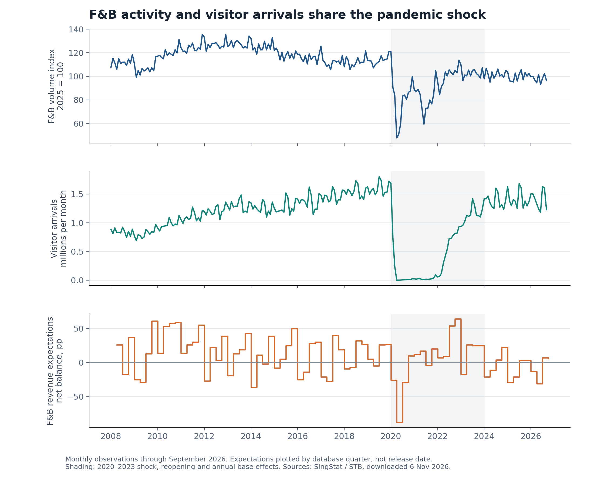
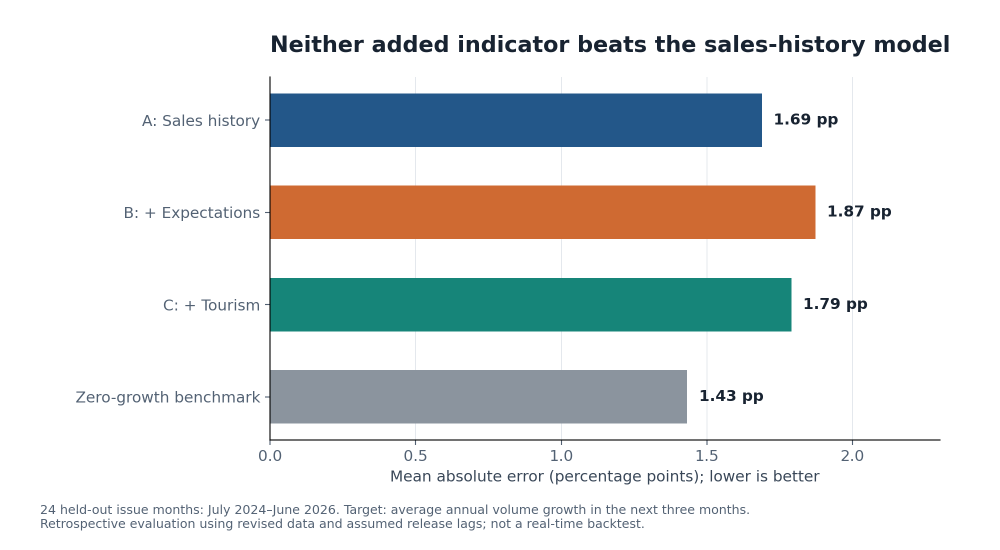
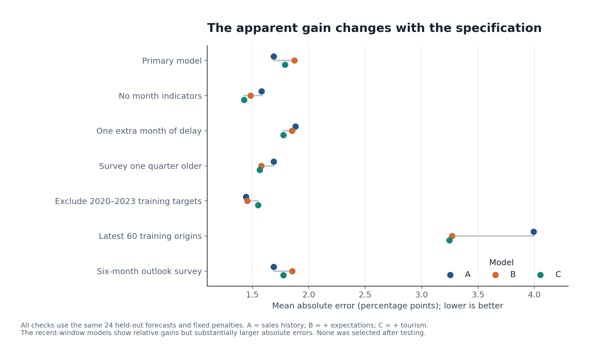

# **Singapore Business Signals — Study 01: Early-Warning Indicators for F\&B Demand**

Data cutoff: 6 November 2026 \| Revised 7 November 2026 \| Retrospective benchmark study \| Version 1.0

DOI: [10.5281/zenodo.24039615](https://doi.org/10.5281/zenodo.24039615) \| Code and data: [https://github.com/Kai-0501/singapore-business-signals](https://github.com/Kai-0501/singapore-business-signals)

**Alfred Ling**

Independent researcher, Singapore

7 November 2026

*AI-assisted: source collection, computation and drafting were done with AI tools under the author's direction and review. The methodological reviews are AI-generated and internal, not academic peer review. Public data only. Views are personal and do not represent any employer.*

# **Executive summary**

Across 24 monthly forecast origins from July 2024 to June 2026, simply forecasting zero growth produced a lower mean absolute error than all three primary fitted models of Singapore F\&B volume growth. The target is the average year-on-year growth across the next three months, with outcomes ending September 2026\. Average absolute errors were 1.432 percentage points for zero growth, 1.689 for sales history, 1.872 after adding revenue expectations, and 1.789 after also adding visitor arrivals. These are results for this model design and period, not evidence that sentiment or tourism lack predictive information.

The test is short, overlapping and concentrated in weak growth: 20 of 24 outcomes were non-positive and their mean was −1.1425%. Tuning was dominated by pandemic-era losses, and all three penalties were selected at the upper edge of the original search. Calendar controls materially affected performance. Without those controls, the tourism model achieved MAE 1.4259, narrowly below zero growth by 0.0064 percentage points, while its RMSE was worse. Both augmented primary models also reduced RMSE, a measure that gives larger errors more weight. This contrary evidence prevents a blanket “nothing beat zero” or “the indicators do not help” conclusion.

Feasibility classification: FEASIBLE WITH LIMITATIONS. Sufficient long public series exist. A genuine historical real-time test is not established because complete first-release vintages and historical publication dates were unavailable. Results use snapshots downloaded on the cutoff date, conservative assumed release lags, and a frozen methodology. They are retrospective pseudo-out-of-sample evidence. They do not prove that the indicators could never help, or that the reported accuracy was attainable in real time.

# **1\. Research question and contribution**

The exact question is whether F\&B business expectations add predictive information beyond historical F\&B volume sales (H1), and whether international visitor arrivals add information beyond both sales and expectations (H2), when forecasting the arithmetic average of monthly year-on-year volume growth over the following three calendar months. Business formations and cessations are exploratory (H3) and cannot influence the primary model selection.

A targeted review covered official SingStat, STB, ACRA and MTI resources, Singapore university research, and published business-survey and F\&B forecasting studies. SingStat’s Business Insights Tool for Enterprises already provides an F\&B industry dashboard \[1\]. Describing these indicators together is therefore not an original contribution. MTI’s Economic Survey offers established sector context \[2\]. NUS Credit Research Initiative’s TRACE work addresses credit risk, a different outcome \[3\].

Hansson, Jansson and Löf (2005) study business surveys and Swedish GDP forecasting using dynamic factors \[4\]. Their results support testing incremental out-of-sample information, not assuming that it transfers to Singapore F\&B. Groene and Zakharov (2024) examine AI-based outlet sales forecasting in a German franchise setting with granular historical and contextual data \[5\]. That differs from a public-data national volume forecast. The review did not identify an exact published replication of this study’s target, release-lag rules and nested comparisons. This is a modest empirical contribution, not a proven first or a systematic-review claim; inaccessible or unindexed work may exist.

# **2\. Feasibility and data audit**

The primary common source window is January 2008–September 2026, sufficient for more than ten years of overlapping information. Forecast origins begin January 2010 after annual transformations. The latest fully observed three-month target at the cutoff belongs to the June 2026 issue. The selected primary rows are complete and consecutive: 501 monthly F\&B volume observations, 225 monthly arrival observations and 127 quarterly observations for each business-expectations series. No primary observation was imputed.

F\&B volume: SingStat M602211, total Food & Beverage Services Index in chained volume terms, not seasonally adjusted, 2025=100; January 1985–September 2026 \[6\]. Volume removes price effects; applying CPI again would double-deflate it. It differs from nominal sales value, which reflects prices and quantities. For example, this frozen volume series gives July 2026 annual growth of −3.4183%, while the official July news release reported a 1.9% decline in sales value \[12\]. That distinction is consistent with a price effect but is not an independent validation of every stored observation or a measured CPI reconciliation. The index excludes individual stalls in hawker centres, food courts, coffee shops and canteens. September data were released on 5 November 2026; the stated current schedule is the fifth day of the second following month, or next working day.

The 2026 rebasing introduced the 2025 basis with the January 2026 release on 5 March 2026\. It updated weights and coverage, including a changed treatment of categories such as cafés \[7\]. Current historical observations must not be treated as values known at earlier dates. An archived 2017-basis series, M601881, covers January 1985–December 2025 and is retained only for a matched-period sensitivity test. It is never spliced into the new index. This comparison combines rebasing and ordinary revisions; it cannot identify their separate effects.

Business expectations: M250451 supplies the F\&B operating-revenue net weighted balance; M250431 supplies the six-month general outlook for robustness \[8\]. Both cover database quarters 1995Q1–2026Q3. A net balance is the weighted proportion expecting an increase minus that expecting a decrease, in percentage points; it is not expected sales growth. Revenue expectations concern the next three months relative to the previous three, and are nominal. The study’s target is annual real growth, creating a genuine conceptual mismatch.

The database quarter precedes the reference forecast quarter. For example, database 2026Q2 describes July–September expectations released 31 July 2026\. Database 2026Q3 corresponds to the October–December release of 2 November 2026 \[9\]. Treating the database quarter-end as the release date would leak information. The protocol instead permits each quarterly observation two calendar months after its database quarter-end. The workbook keeps assumed eligibility and verified releases in separate columns; most historical actual-release cells remain blank.

Tourism: STB’s total international visitor arrivals are distributed through SingStat M550001 \[10\], January 2008–September 2026, with a 30 October 2026 table-update date. The first-publication date of every historical observation was not recovered. The API adjustment-type field conflicts with the apparent unadjusted series. A direct comparison with the official data.gov.sg mirror found 221 exact matches across 224 overlapping months; the remaining three differed by at most 43 arrivals. The separate explicitly adjusted M550002 series differs substantially. This numerical cross-check supports using M550001 as unadjusted, while retaining and flagging the metadata inconsistency. Arrivals measure visits, not tourist F\&B spending.

Registry: ACRA’s detailed monthly formation and cessation tables M085831 and M085841 include a complete SSIC 56 F\&B row for January 1990–October 2026, retrieved by API pagination on the cutoff \[11\]. These count legal entities, not outlets or economic failures. Official notes document historical adjustments, pandemic processing delays, 2023 processing and striking-off changes, the December 2024 system migration and 2025 normalisation. Aggregate and detailed notes describe some normalisation dates differently. ACRA also attributes a March 2026 aggregate cessation spike to intensified striking-off activity. These are evidence against interpreting raw spikes as demand shocks, not a quantified explanation of F\&B-specific movements. Historical release-vintage reliability and classification continuity were insufficient for Model D; H3 remains untested.

All downloads were made on 6 November 2026 UTC. Dataset inventory and per-download JSON record observation coverage, actual release where verified, source update, download timestamp, URL and SHA-256. These are separate concepts. A table-update timestamp is not necessarily the original publication date. No post-cutoff data were knowingly used. Public API defaults truncate large tables at 5,000 cells: selected primary aggregate rows were complete; targeted pagination recovered the full F\&B registry rows.

*Figure 1\. Verified public observations. Separate panels prevent index levels, arrivals and survey balances from implying comparable units. Expectations are plotted by database quarter, not availability date.*

# **3\. Frozen methodology**

A timestamped protocol and its SHA-256 were saved before examining model performance; penalties were locked after validation and before opening the final test. This is an internal preregistration, not an externally registered study. The protocol is included in the reproducibility package as output/preregistration\_v1.txt (SHA-256 fd528e90…aaa0). No primary model was replaced after the test results became known.

Let V\_m be the published monthly F\&B chained-volume index. Monthly annual growth is g\_m \= 100 × (V\_m / V\_(m−12) − 1). At issue month t, the outcome is Y\_t \= (g\_(t+1) \+ g\_(t+2) \+ g\_(t+3)) / 3\. It is an arithmetic average of three annual rates, not growth of a three-month sales total, and not quarter-on-quarter growth. Every competing model forecasts exactly this same Y\_t. Errors are measured in percentage points.

Forecasts are notionally issued on the 20th at 23:59 Singapore time. The implementation uses sales through t−2, arrivals through t−3 and survey database quarter-end plus two months. Training labels mature under the same sales lag: s+3 ≤ t−2, hence s ≤ t−5. This prevents direct future-label use under the imposed month gates. However, the protocol’s requirement that later verified publication dates override assumed eligibility is not implemented in the frozen code. The code does not consume the actual-release ledger. The two recorded survey releases precede assumed eligibility and do not demonstrate leakage, but incomplete release records prevent a full real-time timing assurance. Revised snapshots also retain hindsight unavailable to historical forecasters.

Training begins with January 2010 origins and expands each month. Validation comprises January 2016–February 2024, 98 origins. March–June 2024 are excluded from tuning so all tuning labels are notionally available at the first test issue. The untouched test covers July 2024–June 2026, 24 origins. Its target windows run August–October 2024 through July–September 2026\. Earlier test labels may enter later expanding training only after maturity; the test is untouched for model choice, not artificially excluded from subsequent lawful learning.

Model A uses an intercept, the latest available annual sales growth, the mean of the latest three available annual growth rates, the same three-month target one year earlier, and 11 issue-month indicators. Model B adds the latest eligible F\&B revenue-expectations balance. Model C adds annual visitor growth measured as 100 × \[log(1+arrivals\_(t−3)) − log(1+arrivals\_(t−15))\]. The log transform accommodates near-zero pandemic arrivals. Survey data are carried forward only after eligibility, without interpolation.

All models are direct ridge regressions: coefficient penalties limit how strongly forecasts react to predictors. Features are standardised within each training sample; the intercept is unpenalised. The original candidate penalties were 0.1, 1, 10 and 100, selected separately by validation MAE, with stronger shrinkage breaking exact ties. All three selected 100, the upper boundary, and all three validation-MAE curves were still declining across the listed candidates. The original search therefore did not establish an interior optimum. There are 14, 15 and 16 slope coefficients plus intercepts; ridge reduces their effective degrees of freedom. Appendix B examines the boundary and regime dependence without replacing the frozen primary models.

Mean absolute error (MAE), the average size of forecast misses, is the primary measure. Root mean squared error (RMSE), which penalises large misses more heavily, and directional accuracy are secondary. Weak demand is Y\_t ≤ 0 and a warning is a forecast ≤ 0, fixed in advance. Meaningful improvement requires both at least 10% and 0.25 percentage points of MAE gain, RMSE no more than 5% worse, improvement in both test halves, preservation under stricter delays and pandemic exclusion, and a positive lower adjusted uncertainty bound. H2 must also meaningfully beat A. These are practical screening rules, not an estimated commercial cost-benefit optimum.

Adjacent target windows overlap. Paired circular moving-block bootstrap intervals use six-origin blocks, 5,000 resamples and seed 20261106\. Descriptive intervals are 95%; the two primary comparisons use 97.5% intervals as a Bonferroni adjustment. With only 24 origins, these are approximate, conditional on fixed fitted forecasts and the observed vintage. They do not capture uncertainty from model selection, regime shifts or revisions. Three non-overlapping cohorts of eight origins provide an additional diagnostic, not a larger independent sample.

# **4\. Results on the untouched test**

Model A — sales history: MAE 1.6891 pp; RMSE 2.3926 pp; mean forecast error \+1.4738 pp; directional accuracy 62.5%.

Model B — add expectations: MAE 1.8725 pp; RMSE 2.2573 pp; mean error −0.4522 pp; directional accuracy 66.7%. MAE deteriorates by 0.1834 pp, or 10.86%, relative to A.

Model C — add tourism: MAE 1.7894 pp; RMSE 2.1867 pp; mean error −0.3004 pp; directional accuracy 66.7%. MAE improves by 0.0831 pp, or 4.44%, relative to B, but deteriorates by 0.1003 pp, or 5.94%, relative to A.

Diagnostic benchmarks: zero growth has MAE 1.4323 and RMSE 1.8815 pp; latest-growth persistence has MAE 2.7235 and RMSE 3.6474 pp; last-year target persistence has MAE 2.2751 and RMSE 3.2441 pp. Zero growth beats all three primary fitted models in this test. This does not establish it as the best forecast in other periods. The test is unusually concentrated near weak growth: the mean outcome is −1.1425%, with 20 of 24 outcomes at or below zero.

*Figure 2\. Pre-specified primary MAE comparison and zero-growth diagnostic. Errors come from identical issue dates and target definitions; lower is better.*

Uncertainty: define gain as comparator MAE minus challenger MAE. B versus A has gain −0.1834 pp, with adjusted 97.5% interval \[−1.0845, 0.7719\]. C versus B has gain \+0.0831 pp, interval \[0.0012, 0.1610\]. C versus A has gain −0.1003 pp, descriptive 95% interval \[−0.8781, 0.6977\]. The tourism increment is narrowly distinguishable from zero under this particular conditional bootstrap, but the entire adjusted interval is below the 0.25 pp practical threshold. No broad claim of statistical or economic reliability follows.

Warning counts are descriptive: A produced 12 true positives out of 20 weak-growth windows and 1 false positive out of only 4 positive-growth windows. B and C each produced 16/20 true positives and 4/4 false positives. Thus recall rose from 60% to 80%, precision fell from 92.3% to 80%, and balanced accuracy fell from 67.5% to 40%. Four overlapping positive-growth windows cannot establish a stable population false-alarm rate. Always predicting weak demand gives 83.3% directional accuracy in this imbalanced sample. These counts are not evidence of operational warning performance.

Neither H1 nor H2 met the locked practical-success criteria in this design. H2 showed a small tourism increment relative to B, but it failed the magnitude and robustness requirements and did not beat A on primary MAE. This is failure to establish a practically useful gain with the tested estimators, not rejection of predictive information in the underlying indicators. H3 was not tested. The benchmark failure, tuning limitations and specification dependence restrict the conclusion to the evaluated models and sample.

# **5\. Adversarial validation and contrary evidence**

Calendar specification is a substantive limitation. Year-on-year growth removes a stable multiplicative annual seasonal pattern, but does not guarantee removal of changing seasonality, trading-day effects or moving holidays. Eleven fixed month indicators are therefore not inherently invalid, yet need a strong justification for this target and may add estimation noise; they do not explicitly represent Chinese New Year moving between January and February. Removing them at the locked penalties improves A/B/C MAE to 1.5819/1.4831/1.4259 pp. C narrowly beats zero growth (1.4323) by 0.0064 pp, about 0.45%, but has worse RMSE (2.1125 versus 1.8815). Its MAE gain over the matching A is 0.1561 pp or 9.87%, below the original thresholds. This pre-specified alternative remains evidence against the primary calendar choice, not a replacement primary result chosen after testing.

Publication delay: imposing one extra month of delay gives MAE 1.8823/1.8522/1.7754 pp. Using a survey one quarter older gives 1.6891/1.5798/1.5644. These results show that the primary ranking is not invariant to timing assumptions. They do not validate the actual historical release calendar. A survey can describe the current reference quarter yet arrive too late for much of it; nominal survey outlook and the next-three-month real annual target are not naturally aligned.

Pandemic training sensitivity: excluding training origins whose targets touch January 2020–December 2023 gives MAE 1.4430/1.4563/1.5504 pp. Tourism now worsens B by 0.0941 pp, showing that its small primary increment is not robust to this training change. The penalty remains the original pandemic-influenced choice; this check changes training rows, not the validation regime or penalty selection. It therefore does not resolve the tuning objection or isolate COVID’s causal effect on the fitted relationships. No causal interpretation of visitor arrivals is warranted.

Training windows and survey choice: the latest-60-origin variant gives MAE 3.9927/3.2703/3.2468 pp. Augmentation helps relatively, but all models perform much worse in absolute terms. Replacing revenue expectations with six-month general outlook gives 1.6891/1.8531/1.7755. Pandemic-dominated validation MAEs at the selected penalties are 9.6928/9.3585/12.9171 pp. Such large differences from the later test reveal major regime dependence; they are not in-sample performance evidence.

Period stability: primary MAEs in the first 12 test origins are 1.8191/2.0596/1.9545, and in the second 12 are 1.5591/1.6853/1.6243. Neither augmented model beats A in either half. Among the three non-overlapping cohorts, augmentation does beat A in the second cohort. Before COVID, the 45-origin validation diagnostic gives 1.8073/1.6795/1.8860. These contrary slices are reported rather than selected as new findings; each is small or belongs to the tuning period.

Revisions and rebasing: on the 15 matched test origins July 2024–September 2025, current-basis A/B/C MAEs are 1.5181/2.0414/1.9279, while archived-2017-basis MAEs are 1.1352/1.8899/1.7858. The ranking persists, but error magnitudes change materially. Both calculations retain current survey and arrival vintages. This is a partial basis/vintage sensitivity, not a reconstruction of what a forecaster actually saw.

*Figure 3\. All pre-specified current-vintage specification checks. Fixed penalties and common test origins are retained. The ranking changes under several defensible choices.*

Computational audit: nine independently fitted scikit-learn ridge forecasts reproduced the custom linear-algebra implementation to floating-point precision. A future-data perturbation check left an earlier issue’s prediction unchanged when only information unavailable under the imposed lags was altered. Target and feature completeness, identical test origins and label maturity were checked. These tests establish calculation and imposed-lag discipline, not authentic historical vintages or publication dates.

# **6\. Limitations, conclusions and publication assessment**

The principal limitations are revised snapshots, an incomplete release calendar and an unimplemented later-release override; only 24 overlapping test origins with four positive-growth outcomes; pandemic-dominated validation and an upper-boundary penalty search; and an influential calendar specification within a narrow model family. Nominal quarter-on-quarter survey expectations also differ conceptually from the annual real-growth target. These limitations can mask useful information or create unstable apparent gains. The primary baseline loses to zero growth, so the experiment cannot establish an operational forecasting success.

The defensible conclusion is period- and design-specific: during this mostly weak-growth evaluation, zero growth outperformed all three primary fitted models on both MAE and RMSE. Indicator additions did not meet the pre-specified practical-success rules. A no-month-controls tourism alternative narrowly beat zero on MAE, and the primary augmented models reduced RMSE relative to sales history. Together these results indicate specification and regime dependence rather than a general absence of useful sentiment or tourism information. Forecast mean alone does not explain the ranking: B and C had mean forecasts closer to the test mean than A, yet higher MAE. Improved RMSE remains relevant, but no business loss function was supplied to justify overriding the primary MAE criterion.

The revised study supports an exploratory research note with AI assistance disclosed and claims confined to the tested models and period. It is not a validated real-time product or an academically peer-reviewed discovery.

A follow-up should lock a fresh design and evaluate genuinely new outcomes. Priorities are a release/vintage ledger with an implemented and tested later-release override; a parsimonious calendar baseline with explicit moving-holiday treatment where justified; an adequately bracketed penalty search; and regime-aware validation, including clearly separated pre-pandemic and recovery periods. Include zero growth and intercept-only training-mean and training-median benchmarks, noting that the median minimises constant-forecast MAE whereas the mean minimises squared error. Align survey horizons where possible. Retuning on this already-inspected test would be exploratory, not a new confirmatory result. ACRA work still requires reconciliation of administrative regimes and entity-versus-outlet definitions.

# **7\. Reproducibility and continuation**

The evidence workbook (output/Singapore\_Business\_Signals\_Study01\_Evidence.xlsx) contains source inventory, definitions, monthly and quarterly data, aligned forecast inputs, selected validation and test forecasts, formulas for outcomes and errors, all fixed robustness predictions, tuning scores, intervals and registry audit data. Forecast coefficients require the supplied Python code; changing spreadsheet inputs alone does not refit a ridge model. The separate bundle preserves raw JSON responses, download metadata, SHA-256 manifest, protocol, model lock, code, environment versions and numerical outputs.

Reproduce from frozen files, not fresh downloads: run code/analyse.py \--stage prepare, then \--stage validate, then \--stage final, followed by code/verify.py and code/deliver.py. The original lock timestamps are preserved in the distributed snapshot; rerunning validation creates new execution timestamps. Compare numerical outputs and selected penalties, not those timestamps. Download code is provided for audit, but refreshing live APIs would create a different vintage and may violate this cutoff.

An included Colab notebook (Study01\_Colab.ipynb) lets readers upload the reproducibility ZIP and rerun the analysis in Google’s hosted runtime without a local Python setup. It verifies the package hashes first. Dependency versions are recorded. No paid data subscription is required.

# **References and source register**

\[1\] SingStat. Business Insights Tool for Enterprises: Food & Beverage Services. [https\://www\.singstat.gov.sg/data-tools-services/business-insights-tool-for-enterprises-bite/know-my-industry/food-and-beverage-services](https://www.singstat.gov.sg/data-tools-services/business-insights-tool-for-enterprises-bite/know-my-industry/food-and-beverage-services) 

\[2\] MTI. Economic Survey of Singapore, First Quarter 2025\. Sector context. [https\://www\.mti.gov.sg/-/media/MTI/Resources/Economic-Survey-of-Singapore/2025/Economic-Survey-of-Singapore-First-Quarter-2025/FullReport\_1Q25.pdf](https://www.mti.gov.sg/-/media/MTI/Resources/Economic-Survey-of-Singapore/2025/Economic-Survey-of-Singapore-First-Quarter-2025/FullReport_1Q25.pdf) 

\[3\] NUS Credit Research Initiative. TRACE news item, F\&B credit-risk context. [https\://nuscri.org/en/news/50/](https://nuscri.org/en/news/50/) 

\[4\] Hansson, J., Jansson, P. and Löf, M. (2005). Business survey data: Do they help in forecasting GDP growth? International Journal of Forecasting 21(2), 377–389. [https\://doi.org/10.1016/j.ijforecast.2004.11.003](https://doi.org/10.1016/j.ijforecast.2004.11.003) . Public working-paper version: [https\://archive.riksbank.se/pagefolders/8107/WP\_151.pdf](https://archive.riksbank.se/pagefolders/8107/WP_151.pdf) 

\[5\] Groene, N. and Zakharov, S. (2024). Introduction of AI-based sales forecasting: how to drive digital transformation in food and beverage outlets. Discover Artificial Intelligence. [https\://link.springer.com/article/10.1007/s44163-023-00097-x](https://link.springer.com/article/10.1007/s44163-023-00097-x) 

\[6\] SingStat. F\&B chained-volume index M602211. [https\://tablebuilder.singstat.gov.sg/table/TS/M602211](https://tablebuilder.singstat.gov.sg/table/TS/M602211) . September 2026 release: [https\://www\.singstat.gov.sg/news/monthly-retail-sales-index-and-food-beverage-services-index-sep2026](https://www.singstat.gov.sg/news/monthly-retail-sales-index-and-food-beverage-services-index-sep2026) 

\[7\] SingStat. Rebasing of Retail Sales and Food & Beverage Services Indices to Base Year 2025, April 2026\. [https\://www\.singstat.gov.sg/files/c7a9888f-a87c-41fe-97cb-d82669d65bb6.pdf](https://www.singstat.gov.sg/files/c7a9888f-a87c-41fe-97cb-d82669d65bb6.pdf)  . Archived series: [https\://data.gov.sg/datasets/d\_42cb05dd61cddf473a8ba82cd10c7e34/view](https://data.gov.sg/datasets/d_42cb05dd61cddf473a8ba82cd10c7e34/view) 

\[8\] SingStat. Business Expectations of Services: definitions. [https\://www\.singstat.gov.sg/find-data/explore-data-themes/industry/business-expectations/our-data-explained](https://www.singstat.gov.sg/find-data/explore-data-themes/industry/business-expectations/our-data-explained) . Revenue table: [https\://tablebuilder.singstat.gov.sg/table/TS/M250451](https://tablebuilder.singstat.gov.sg/table/TS/M250451) . General outlook: [https\://tablebuilder.singstat.gov.sg/table/TS/M250431](https://tablebuilder.singstat.gov.sg/table/TS/M250431)

\[9\] SingStat. Business Expectations of Services Sector, 4Q2026, released 2 November 2026\. [https\://www\.singstat.gov.sg/news/business-expectations-of-services-sector-4q2026](https://www.singstat.gov.sg/news/business-expectations-of-services-sector-4q2026) . 3Q2026 release, 31 July 2026: [https\://www\.singstat.gov.sg/news/business-expectations-of-services-sector-3q2026](https://www.singstat.gov.sg/news/business-expectations-of-services-sector-3q2026)

\[10\] STB. Tourism Statistics. [https\://stan.stb.gov.sg/content/stan/en/tourism-statistics.html](https://stan.stb.gov.sg/content/stan/en/tourism-statistics.html) . Unadjusted arrivals distributed by SingStat: [https\://tablebuilder.singstat.gov.sg/table/TS/M550001](https://tablebuilder.singstat.gov.sg/table/TS/M550001) . Official mirror: [https\://data.gov.sg/datasets/d\_d1c33009b674dcf70b8e8c790b793f28/view](https://data.gov.sg/datasets/d_d1c33009b674dcf70b8e8c790b793f28/view) . Adjusted comparator: [https\://tablebuilder.singstat.gov.sg/table/TS/M550002](https://tablebuilder.singstat.gov.sg/table/TS/M550002)

\[11\] ACRA. Business Registry Statistics. [https\://www\.acra.gov.sg/resources/business-registry-statistics/](https://www.acra.gov.sg/resources/business-registry-statistics/) . Detailed formations: [https\://tablebuilder.singstat.gov.sg/table/TS/M085831](https://tablebuilder.singstat.gov.sg/table/TS/M085831) . Detailed cessations: [https\://tablebuilder.singstat.gov.sg/table/TS/M085841](https://tablebuilder.singstat.gov.sg/table/TS/M085841)

\[12\] SingStat. Monthly Retail Sales Index and Food & Beverage Services Index, July 2026, published 7 September 2026\. [https\://www\.singstat.gov.sg/news/monthly-retail-sales-index-and-food-beverage-services-index-jul2026](https://www.singstat.gov.sg/news/monthly-retail-sales-index-and-food-beverage-services-index-jul2026) . Accessed 7 November 2026\. Definition cross-check: reference \[7\], current-price and chained-volume measures.

Web sources were accessed on 6 November 2026, except reference \[12\], accessed 7 November 2026\. Downloaded source timestamps and hashes are recorded separately. Statistical claims are calculations from the frozen study files, not claims copied from these sources.

# **Appendix A. Reconciliation of Versions A and B — 6 November 2026**

*Provenance note: an earlier parallel analysis (Version A, 2017-base series) was run before this study. Its materials are not part of this public release; this appendix records how the two versions differ so the choice of Version B is transparent.*

6 November 2026

## **Decision and scope**

Version B is the canonical reference for the frozen-vintage retrospective Study 01, together with this reconciliation. Version A remains a preserved archived-series analysis. This is an editorial choice based on current-series coverage through September 2026, explicit benchmarks, per-model validation and a matched-vintage sensitivity. It is not a claim that B's lower headline MAE proves it is a superior forecasting method. Neither version establishes a validated real-time warning system.

## **The two versions are distinct experiments**

Version A evaluates October 2023–September 2025 origins on the 2017-base series. Its sales-history, expectations and tourism MAEs are 1.745318, 1.862841 and 1.852745 pp. Version B evaluates July 2024–June 2026 origins on the 2025-base series; corresponding MAEs are 1.689090, 1.872457 and 1.789391 pp. Both forecast the mean of the next three monthly annual volume-growth rates. Their test windows share 15 origins and must not be treated as independent replications or pooled into one estimate.

Both use sales through t−2, arrivals through t−3 and survey database quarter-end plus two months. Both require training origin s≤t−5. A issues at month-end and B on the 20th. A uses two seasonal harmonics, annual lag g(t−14), and survey level plus annual change. B uses eleven month indicators, prior-year matching target Y(t−12), and survey level alone. A uses log arrival ratios; B uses log(1+arrivals) differences. A validates on 76 origins from January 2017; B on 98 from January 2016\.

A selects a common penalty from baseline validation. B validates each model separately. A minimises mean squared loss plus lambda times squared slopes, with lambda=1, equivalent to scikit-learn alpha=n at each fit. B uses sum squared loss plus alpha times squared slopes, with alpha=100. Thus “1 versus 100” is not a direct comparison of shrinkage. The pandemic exclusions, shorter training windows, zero-growth treatment and number of bootstrap replications also differ. These are genuine design differences, not demonstrated errors.

## **Rebasing and source reconciliation**

A fixed multiplicative change of index scale cancels out of year-on-year growth. The difference cannot be explained merely by changing the label from 2017=100 to 2025=100. Official documentation describes revised classifications, weights and historical linking; the March information paper and April newsletter are both valid references. The current basis began with January 2026 data released on 5 March 2026\.

The frozen current-to-old FSI ratio is not constant. Over January 2008–December 2024 it ranges from 0.983562 to 1.173889. The largest annual-growth difference is 17.944827 pp in June 2022: 50.883960% archived versus 68.828786% current. The exact contributions of revisions, chaining, coverage or backcasting have not been reconciled against an official observation-level revision record. These figures are vintage differences, not a pure rebasing-effect estimate.

The current frozen response identifies M602211 Total, chained volume and non-seasonally-adjusted data, with 501 observations and a matching recorded hash. A fresh full API comparison was attempted during this audit but returned HTTP 403; browser-readable retrieval did not expose the numerical table. Independent redownload and reconciliation of the historical changes remain open source-validation checks. The stored series and computations are verified against the supplied evidence, not newly authenticated first releases.

The two packages' old FSI values match in all 492 shared months, and revenue expectations match in all 126 shared quarters. Tourism differs only in May, June and July 2026 by 1, 1 and 43 arrivals respectively. Those months are outside both versions' primary predictor inputs, so these particular tourism revisions cannot explain the result discrepancy. B's stored mirror and adjusted-series checks reproduce, but its inconsistent tourism adjustment metadata remains disclosed.

## **Matched common-window check**

A post-hoc audit crosses the frozen designs and FSI vintages over July 2024–September 2025, holding original penalties fixed. MAEs, in order sales history / expectations / tourism, are:

• A design, archived FSI: 1.019915 / 1.868506 / 1.819036.

• A design, current FSI: 1.528007 / 2.019025 / 1.944534.

• B design, archived FSI: 1.135185 / 1.889948 / 1.785849.

• B design, current FSI: 1.518129 / 2.041384 / 1.927884.

The two B rows reproduce its originally specified vintage check. The expanded four-way comparison is post hoc. All four cells favour the matching sales-history baseline on primary MAE. The results show that window, vintage and specification all matter; they do not allocate the difference additively or causally. The old series cannot evaluate B's final nine origins without unavailable observations.

## **Contrary evidence and new audit diagnostics**

Retain A's annual-change-only sentiment improvement of 7.4%, favourable first test half and favourable eight-origin cohort, alongside their failures elsewhere. Retain B's RMSE improvements, favourable alternatives without month indicators or with an older survey, and its small tourism gain versus expectations. These results do not satisfy the frozen overall success rules and must not replace the primary model after testing.

A zero-growth diagnostic newly calculated during reconciliation has MAE 1.117584 pp and RMSE 1.631832 pp, outperforming A's three fitted models. It was not preregistered in A and is labelled post hoc. B's originally specified zero-growth MAE is 1.432265 pp.

B's original six-month-block 97.5% interval for the tourism increment is \[0.001247, 0.161026\] pp. Audit-only sensitivity intervals using three and twelve months are \[−0.012297, 0.176369\] and \[0.051580, 0.117246\]. The three-month interval includes zero. These additional checks do not replace the original interval; they show why its narrow positive lower bound should not be described as robust significance. Even the original interval is below the 0.25 pp practical threshold.

The warning denominators differ: A's augmented models detect 8/13 weak windows with 9/11 false alarms; B's detect 16/20 with 4/4 false alarms. Do not transfer or pool those counts. H3 remains untested, not rejected.

## **What reproduced**

All 50 A manifest entries and 90 B entries matched their hashes. Unmodified frozen-data pipelines reproduced validation selections, primary results, robustness results and uncertainty calculations. Separately reconstructed features and scikit-learn fits reproduced all 72 A forecasts within 1.4×10⁻¹⁵ pp and all 72 B forecasts within 2.7×10⁻¹⁵ pp. Targets and month-based maturity gates were checked. The native Sheets' 24 A test rows and 72 B primary test rows match their frozen targets, predictions and dates exactly; headline formulas select the intended test rows. This was a targeted analytical audit, not exhaustive visual/formula verification of every cell.

A protocol hash: afcdd398dfb911cfc3eacd39df1818e2d2ac2571871e32e1442e72a59157d9e2.

B protocol hash: fd528e90639ccc8e16fbff58cd450c239b0f92bf11c82accf840456a8f61aaa0.

B's cloud protocol matches its frozen text after whitespace/BOM normalisation. The standalone PREREGISTRATION.md is A's protocol.

Internal timestamps and hashes do not prove externally attested preregistration or analyst blinding. Neither study is externally registered; this reconciliation is necessarily post hoc. Existing claims of an “untouched” test refer to the recorded original workflow, not a newly certified independent history.

## **Corrections and unresolved checks**

Growth targets are percentages; errors and net survey balances are percentage points. This corrects terminology in both frozen protocols without changing any numbers.

B's protocol says later verified releases override assumed eligibility, but its model code applies month gates and does not consume an actual-release override ledger. The two recorded survey dates precede assumed eligibility and do not demonstrate leakage. The safeguard is nevertheless not fully implemented. A real-time extension needs a complete release/vintage ledger, an explicit later-release override and a test of that boundary.

The largest source-validation follow-up is an independent exact M602211 export and an official explanation or correction of the nonconstant historical differences. Do not silently attribute them to simple rebasing. Complete first-release values, historical publication dates and comprehensive revision attribution remain unavailable.

## **Related official sources**

Official rebasing information paper: [https\://www\.singstat.gov.sg/files/88ad508d-7d5b-4fff-8e50-01ab855059cd.pdf](https://www.singstat.gov.sg/files/88ad508d-7d5b-4fff-8e50-01ab855059cd.pdf) 

Official rebasing newsletter: [https\://www\.singstat.gov.sg/files/c7a9888f-a87c-41fe-97cb-d82669d65bb6.pdf](https://www.singstat.gov.sg/files/c7a9888f-a87c-41fe-97cb-d82669d65bb6.pdf) 

# **Appendix B. Response to methodological review — 7 November 2026**

## **Scope and verification**

This dated post-hoc audit responds to an AI-generated methodological critique commissioned by the author. It leaves the original model locks, test forecasts, workbook and archived reproducibility package unchanged. All 90 original manifest entries passed SHA-256 verification. All 24 target values were reconstructed from the frozen M602211 index; independent NumPy ridge calculations using the native workbook’s aligned inputs reproduced all 72 primary forecasts within 2.0×10⁻¹⁵ pp and matched the archived prediction file. MAE, RMSE, bias and warning counts were recalculated. This verifies the supplied computation, not authentic first-release vintages or the historical analyst-blinding record.

## **1\. Pandemic dominance and the search boundary: accepted, with qualification**

Validation targets span −51.9676% to \+51.9648%. Fifty of the 98 validation origins have at least one target month in January 2020–December 2023\. At the selected penalty of 100, these origins account for 90.72%, 91.33% and 92.99% of total absolute validation error for A/B/C. The critique is right that this regime dominates the loss used for tuning and that an upper-boundary selection should have been explicit.

A diagnostic extension of the validation grid to 1,000 and 10,000 was run after the critique, without inspecting new final-test variants or changing the original selection. A/B/C validation MAEs at 100 are 9.6928/9.3585/12.9171; at 1,000 they are 10.2921/10.1889/9.6024; at 10,000 they are 10.6020/10.5876/10.4165 pp. Thus C’s original grid was materially restrictive; A and B do not continue improving at these larger candidates. This coarse extension does not establish a global optimum. On the original grid evaluated only over the 45 pre-COVID origins through September 2019, A favours 10 and B/C still favour 100\. Pandemic dominance is established; a claim that COVID alone caused every boundary choice is not.

## **2\. Shrinkage did not collapse the models to their training mean**

The issue-specific training mean falls from approximately \+0.8142% to \+0.5774%, averaging \+0.6737%. Primary A/B/C mean forecasts are \+0.3313%, −1.5948% and −1.4429%, with forecast standard deviations 0.9326, 1.3116 and 1.2764 percentage points. Mean absolute departures from the corresponding training mean are 0.8874, 2.3194 and 2.1708 pp. A post-hoc intercept-only training-mean diagnostic has MAE 1.9551 and RMSE 2.3517 pp. These results reject the explanation that all three models mostly issued the same \+0.8% forecast. Ridge shrinks slopes, but alpha=100 under a sum-squared-error objective does not imply negligible predictors. B/C are closer to the test mean than A yet have worse MAE, so average-level proximity alone cannot explain accuracy.

## **3\. Calendar controls: consequential weakness, not an algebraic prohibition**

The no-month-controls alternative improves all three MAEs at unchanged penalties. That is strong evidence to foreground the weakness of this primary specification. It does not prove that all calendar terms are invalid for year-on-year data: changing seasonal patterns and moving holidays can survive annual differencing. Fixed month indicators are not an explicit moving-holiday adjustment. Selecting the better alternative after seeing the test would not restore an untouched evaluation. The tourism alternative’s 0.006409 pp MAE advantage over zero growth is descriptive and tiny; its RMSE is about 12.27% worse. No new significance claim is made.

## **4\. Sample size, release timing and headline: accepted**

Twenty of 24 targets are non-positive; adjacent three-month windows overlap. The 4/4 false-positive count is accurate but too sparse and dependent to establish a durable false-alarm rate. Blocks and every-third-origin cohorts cannot manufacture independent observations or repair the regime imbalance. The missing verified-date override is an implementation gap, even though the two documented survey releases do not show leakage. The main text now states this directly. The appropriate headline is: “Zero growth beat the three primary fitted models in this 2024–26 weak-growth test; a calendar alternative narrowly improved MAE, without establishing robust predictive value.”

## **5\. Reproducibility of this appendix**

The original computation is frozen and unchanged. The forecast-mean, departure and validation-share diagnostics above can be recalculated from the included prediction and tuning files. The extended-grid validation figures (penalties 1,000 and 10,000) came from a separate diagnostic script that is not part of this release; treat them as reported rather than independently reproducible from the package.
